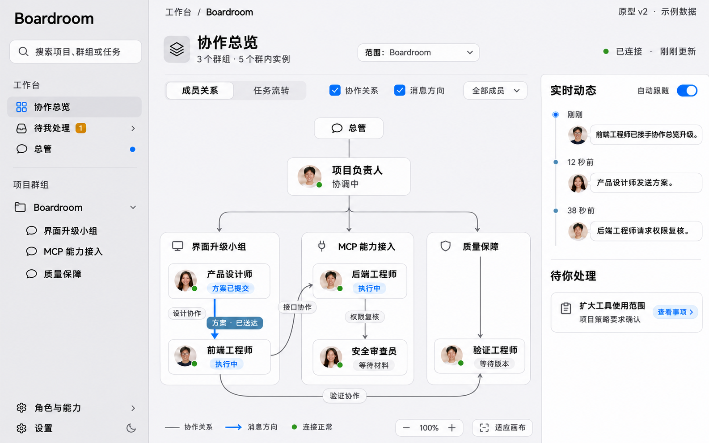
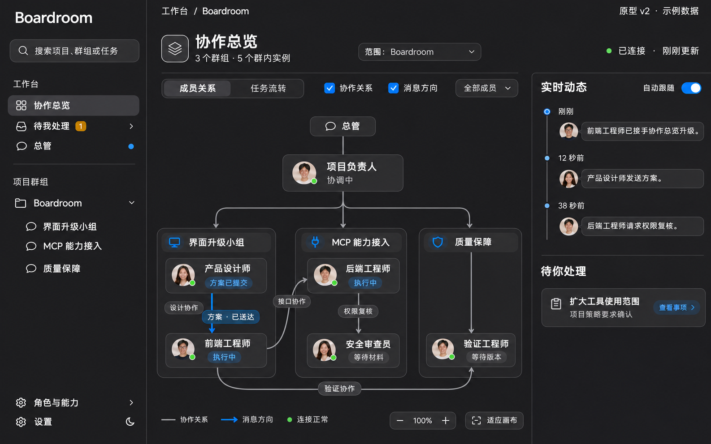
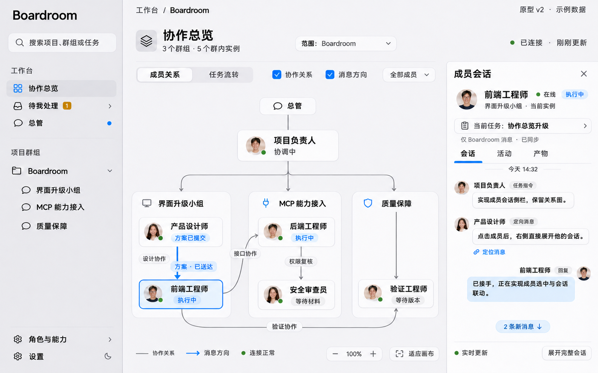
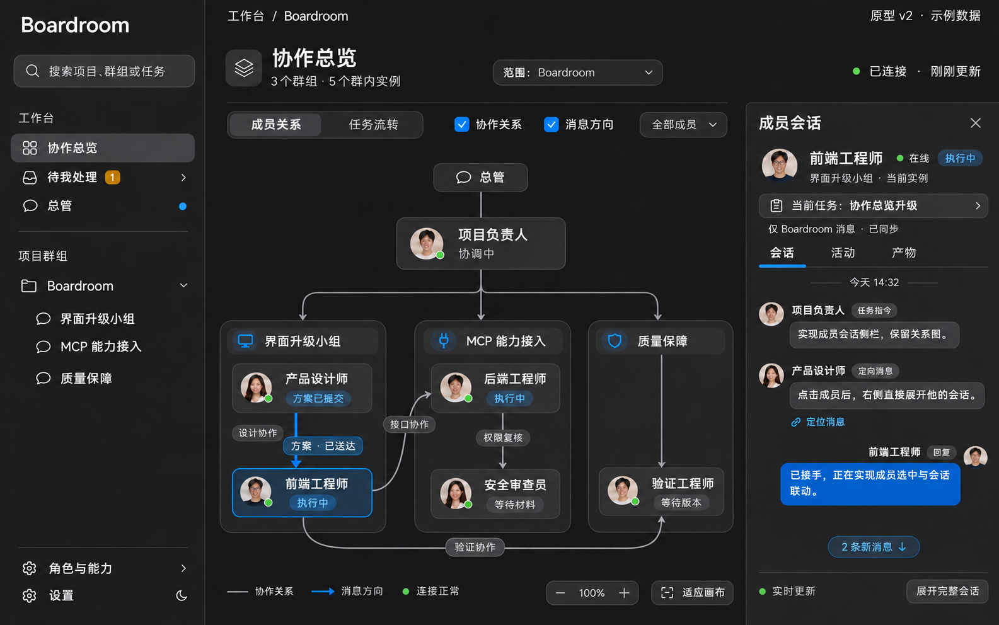
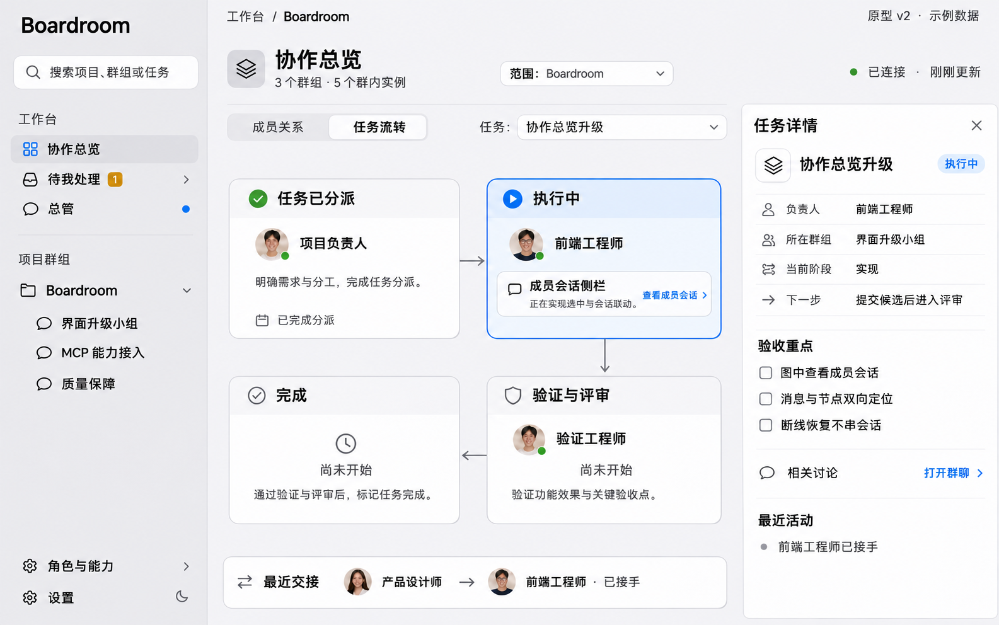
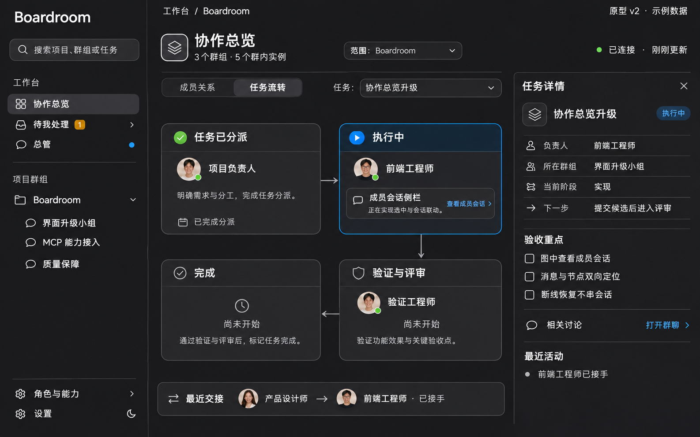
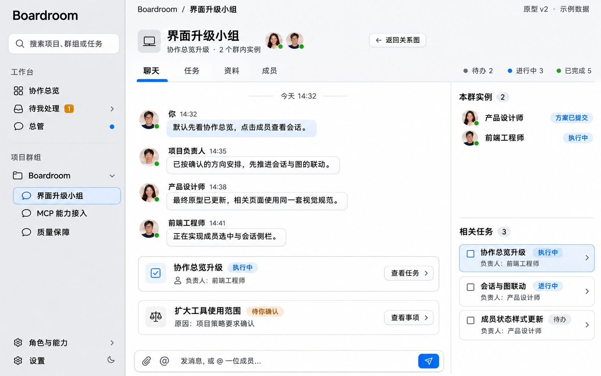
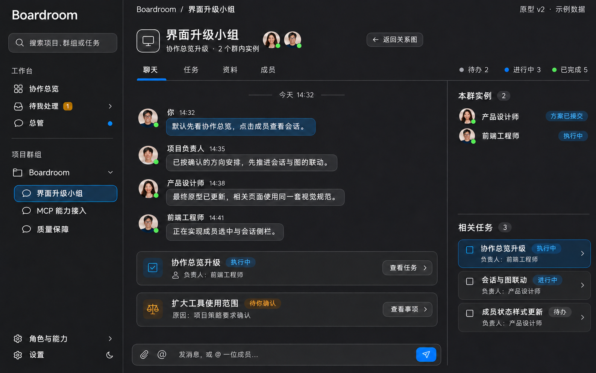
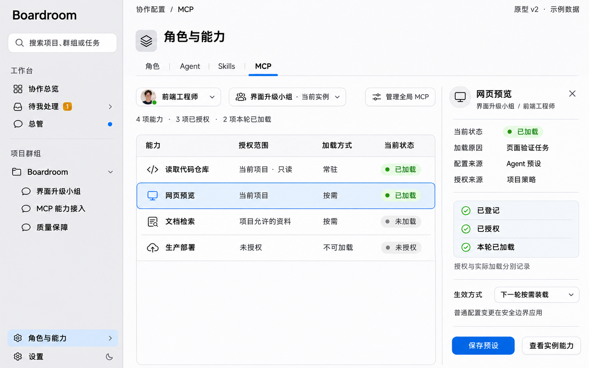
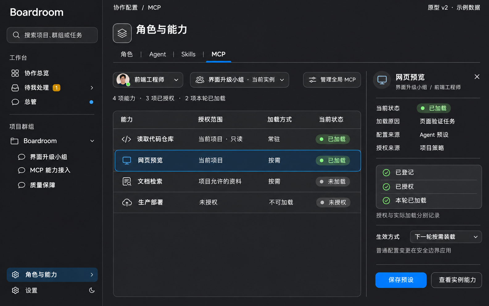

# Boardroom 协作界面原型 v2

- 原型身份：BR-COLLAB-PROTOTYPE-20261112-v2；2026-11-12。
- 权威规格：[主 Spec #122 r3](https://github.com/gbcdby/boardroom/issues/122)、[S6 #123 r4](https://github.com/gbcdby/boardroom/issues/123)、[S7 #142 r1](https://github.com/gbcdby/boardroom/issues/142)。
- 本目录只归档原型图片、索引和验证附件。详细交互、状态、权限、验收与进度以对应 Issue 为准，不在仓库复制第二份 Spec。
- 用户已确认此轮中性 Apple 配色方向，并要求支持黑暗模式。v2 替代本轮早期 v1 配色；当前基准是五类页面各浅色/深色一份，共 10 张。

## 页面与主题预览

点击图片可打开原图。每张图包含“原型 v2 · 示例数据”标记。

| 页面 | 浅色 | 深色 |
| --- | --- | --- |
| P01 默认协作总览：群架构、成员关系、消息方向、动态与待处理 |  |  |
| P02 图内成员会话：选中具体群实例，保留关系图 |  |  |
| P03 任务流转：阶段、负责人、下一步与验收点 |  |  |
| P04 群组聊天：消息、任务与 Decision 卡片 |  |  |
| P05 角色与 MCP：配置、授权、按需加载及实际状态 |  |  |

## 基准的适用范围

图片固定本轮布局和视觉方向：聊天式侧栏、默认协作图、右侧成员会话、中性白灰/石墨灰和克制的蓝色强调。浅色、深色、跟随系统，以及首帧、持久偏好、主题切换状态保持的合同见 S6 §9.8。

人物、时间、数量、工作状态、投递状态和能力均为演示数据，不证明产品已经运行。成员关系来自实际配置/任务，消息送达不等于接手，成员会话受实例/权限/数据覆盖约束，具体以 S6 和 S7 的规范为准。

这是生成式静态设计图，不是可执行原型或真实浏览器截图。图中像素取色不是精确主题 token 的来源；正文/状态/边界必须在实际实现中满足 S6 对比与可访问性要求。关系图动画、断线恢复、主题切换、窄屏和键盘行为仍须运行验证，当前均为 NOT_RUN。

## 文件身份

[manifest.json](manifest.json) 记录 10 张原始 PNG 的相对路径、尺寸、字节数与 SHA256。文件名与原型 ID 在浅/深主题之间一一对应；后续视觉修改应使用新版本并在 Spec 中明确替代关系。

此归档通过独立分支和 PR 提交。归档完成、设计审查、实现、合并、发布是分别记录的事实。

